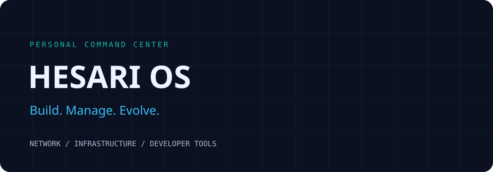

# HESARI OS

**Build. Manage. Evolve.**



An open-source Cloudflare Workers / Pages configuration panel for VLESS, Trojan,
WARP, subscriptions, QR codes and private DNS. Built on the BPB Worker Panel
networking engine with a personalized HESARI OS interface.

[فارسی](README_fa.md) · [Releases](https://github.com/mjhesari/Hesari-Os/releases) · [Documentation](https://github.com/mjhesari/Hesari-Os/blob/main/docs/en/docs/index.md) · [MJ Hesari](https://mj-hesari.ir)

## Install

Use Node.js 24 LTS (minimum 22.12) and your own Cloudflare account.

```sh
git clone https://github.com/mjhesari/Hesari-Os.git
cd Hesari-Os
npm ci
mkdir -p .local
cp settings.example.json .local/settings.json
```

Fill in `.local/settings.json` using your own settings:

| Field | Value |
| --- | --- |
| `accID` | Cloudflare account ID |
| `accEmail` | Your Cloudflare email; also your panel login username |
| `apiToken` | API token for the account-management functions used by the panel |
| `vlUUID` | A version 4 UUID; generate with `node -p 'crypto.randomUUID()'` |
| `trPass` | Your random Trojan password |
| `securePath` | A long random path using letters, digits, underscores and hyphens |
| `mainDomain` | The Worker's native hostname, such as `hesari.your-subdomain.workers.dev` |
| `kvNamespaceId` | Existing KV namespace ID, required for CLI deployment |

`mainDomain` must identify the Worker you intend to manage. Keep the original
hostname, credentials, private path and KV namespace when upgrading a panel.

## Run the actual Worker locally

```sh
npm run dev
```

Open `http://localhost:8787/<securePath>/panel`, enter the configured account email
and create a password. This runs the production Worker in Cloudflare's local
runtime with persistent KV under `.local/state`. Login, settings APIs and
subscription generation execute the real application code. External DNS, WARP,
Telegram and Cloudflare management actions use their real services. Changing
embedded main settings can redeploy the configured Worker; use a dedicated
Worker for development.

There is no demo server or simulated product mode. `npm run build-dev` builds an
unminified Worker for debugging.

## Deploy to Cloudflare Workers

Create a KV namespace in your Cloudflare account and put its ID in
`kvNamespaceId`. Then:

```sh
npm run deploy:check  # validate and prepare a deployment without uploading
npm run deploy       # build and deploy your configured Worker and KV binding
```

For manual installation instead:

```sh
npm run build
npm run configure < .local/settings.json
```

Upload the contents of `.local/worker.js` as a Worker module, enable
`nodejs_compat` with compatibility date `2026-06-03` or later, and bind your KV
namespace as **`kv`**. Remove legacy `UUID` and `TR_PASS` environment variables.
Open `https://<mainDomain>/<securePath>/panel` and set your login password.

Pages deployments use the same configured module as `_worker.js`, a `kv`
binding, and `CF_PAGES=1`. CLI deployment above targets Workers.

The public release is `dist/worker.js` plus `dist/manifest.json`. The configured
`.local/worker.js` contains your account token: never publish or share it.

## Updates and verification

The panel checks the latest HESARI OS release manifest and downloads
`worker.js` from **this repository** when you choose Update. It retains your
embedded account settings and KV namespace. BPB Wizard's default install source
is upstream BPB; installing its default output replaces the customized UI.

```sh
npm run check
npm test
npm run docs:brand
```

Tests execute the compiled release Worker with isolated KV and mocked external
providers: first-time setup, authentication, settings validation/persistence,
all supported subscription formats, QR codes, WARP renewal, usage, self-update
and logout. They do not verify end-to-end live proxy reachability or deploy to
your account. GitHub Actions is not enabled. Optional workflow templates are stored in `automation/github-actions/`; run these checks locally.

Branding and release URLs live in `src/branding.json`. Shared UI styles are in
`src/assets/shared/theme.css`. See [CONTRIBUTING.md](CONTRIBUTING.md),
[SECURITY.md](SECURITY.md), [NOTICE](NOTICE) and [LICENSE](LICENSE).

HESARI OS preserves BPB's original credits and GPL-3.0 license. Third-party
network rule lists, client downloads and networking services retain their
original providers. Project/task/notes management is outside this panel's scope.

## Features

1. **Free and Private**: No costs involved and the server is private.
2. **Intuitive Panel:** Streamlined for effortless navigation, configuration and use.
3. **Versatile Protocols:** Provides VLESS, Trojan and Wireguard (Cloudflare Warp) protocols.
4. **Private DoH:** A ready to use DoH server, capable of customizing underlying DNS server.
5. **Warp Pro configs:** Optimized Warp for crucial circumstances.
6. **Fragment support:** Supports Fragment functionality for crucial network situations.
7. **Comprehensive Routing Rules:** Bypassing Iran/China/Russia, Blocking QUIC, Porn, Ads, Malwares, Phishing and also bypassing sanctions.
8. **Chain Proxy:** Capable of adding a chain proxy (VLESS, Trojan, Shadowsocks, socks and http) to fix IP.
9. **Broad client compatibility:** Offers subscription links for Xray, Sing-box and Clash-Mihomo core cross-platform clients.
10. **Password-protected panel:** Provides secure and private panel with full authentication.
11. **Fully customizable:** Supports setting up clean IPs-domains, Proxy IPs, DNS servers, choosing ports and protocols, Warp endpoints and more.
12. **Node ability:** Can share settings and proxies across other BPB users.
13. **Proxy aggregation:** Supports aggregating another proxies into BPB proxies and deliver in a single subscription.

## Limitations

1. **UDP transport**: VLESS and Trojan protocols on workers do not handle **UDP** properly, so it is disabled by default (affecting features like Telegram video calls), UDP DNS is also unsupported. DoH is enabled by default for enhanced security.
2. **Request limit**: each worker supports 100K requests per day for VLESS and Trojan, suitable for 2-3 users. You can use limitless Warp configs.

## Getting started

- [Installation methods](docs/en/docs/wizard.md)
- [Configuration](docs/en/docs/configuration/index.md)
- [How to use](docs/en/docs/usage/index.md)
- [FAQ](docs/en/docs/faq.md)

## Supported Clients

|       Client        | Minimum version |  Fragment support  |  Warp Pro support  |
| :-----------------: | :-------------: | :----------------: | :----------------: |
|     **v2rayNG**     |      2.2.3      | :heavy_check_mark: | :heavy_check_mark: |
|     **MahsaNG**     |       16        | :heavy_check_mark: | :heavy_check_mark: |
|     **v2rayN**      |     7.22.5      | :heavy_check_mark: | :heavy_check_mark: |
|    **Streisand**    |     1.6.71      | :heavy_check_mark: | :heavy_check_mark: |
|    **Sing-box**     |     1.12.0      | :heavy_check_mark: |        :x:         |
|      **husi**       |      1.3.2      | :heavy_check_mark: |        :x:         |
|   **Clash Meta**    |                 |        :x:         | :heavy_check_mark: |
| **Clash Verge Rev** |                 |        :x:         | :heavy_check_mark: |
|     **FLClash**     |                 |        :x:         | :heavy_check_mark: |
|    **Wireguard**    |                 |        :x:         |        :x:         |
|   **AmneziaVPN**    |                 |        :x:         | :heavy_check_mark: |
|    **WG Tunnel**    |                 |        :x:         | :heavy_check_mark: |

---

### Special Thanks

- VLESS, Trojan [Cloudflare-workers/pages proxy script](https://github.com/yonggekkk/Cloudflare-workers-pages-vless) by [yonggekkk](https://github.com/yonggekkk)
- CF-vless code author [3Kmfi6HP](https://github.com/3Kmfi6HP/EDtunnel)
- CF preferred IP program author [badafans](https://github.com/badafans/Cloudflare-IP-SpeedTest), [XIU2](https://github.com/XIU2/CloudflareSpeedTest)
