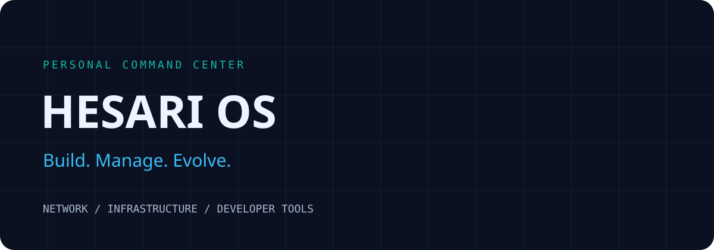

# HESARI OS

**Build. Manage. Evolve.**



پنل متن‌باز مدیریت کانفیگ روی Cloudflare Workers و Pages برای VLESS، Trojan، WARP، لینک اشتراک، QR Code و DNS خصوصی؛ با هستهٔ شبکهٔ BPB Worker Panel و رابط اختصاصی HESARI OS.

[English](README.md) · [نسخه‌های انتشار](https://github.com/mjhesari/Hesari-Os/releases) · [مستندات](https://mjhesari.github.io/Hesari-Os/fa/) · [MJ Hesari](https://mj-hesari.ir)

## نصب

از Node.js 24 LTS استفاده کنید؛ حداقل نسخهٔ لازم 22.12 است. هر نصب به حساب و تنظیمات Cloudflare خودتان نیاز دارد.

```sh
git clone https://github.com/mjhesari/Hesari-Os.git
cd Hesari-Os
npm ci
mkdir -p .local
cp settings.example.json .local/settings.json
```

فایل `.local/settings.json` را با اطلاعات واقعی خودتان تکمیل کنید:

| فیلد | مقدار |
| --- | --- |
| `accID` | شناسهٔ حساب Cloudflare |
| `accEmail` | ایمیل حساب؛ نام کاربری ورود به پنل نیز همین است |
| `apiToken` | توکن API با دسترسی عملیات مدیریتی مورد استفادهٔ پنل |
| `vlUUID` | UUID نسخهٔ ۴؛ ساخت با دستور `node -p 'crypto.randomUUID()'` |
| `trPass` | رمز تصادفی Trojan |
| `securePath` | مسیر طولانی و تصادفی با حروف، اعداد، خط تیره و زیرخط |
| `mainDomain` | دامنهٔ اصلی Worker مانند `hesari.your-subdomain.workers.dev` |
| `kvNamespaceId` | شناسهٔ فضای KV موجود؛ برای استقرار با CLI لازم است |

`mainDomain` باید متعلق به همان Worker باشد که می‌خواهید مدیریت کنید. هنگام ارتقای پنل موجود، دامنه، اطلاعات حساب، مسیر خصوصی و فضای KV فعلی را حفظ کنید.

## اجرای واقعی در محیط محلی

```sh
npm run dev
```

آدرس `http://localhost:8787/<securePath>/panel` را باز کنید، ایمیل تنظیم‌شده را وارد کنید و رمز ورود بسازید. این دستور، خود Worker را در محیط محلی Cloudflare اجرا می‌کند. ورود، API تنظیمات و تولید اشتراک واقعی‌اند و KV در `.local/state` ذخیره می‌شود. سرویس‌های بیرونی DNS، WARP، تلگرام و مدیریت حساب Cloudflare به API واقعی متصل می‌شوند. تغییر تنظیمات اصلیِ تعبیه‌شده می‌تواند Worker تنظیم‌شده را مجدداً مستقر کند؛ برای توسعه از یک Worker اختصاصی استفاده کنید.

سرور نمایشی یا حالت محصول شبیه‌سازی‌شده وجود ندارد. دستور `npm run build-dev` خروجی Worker بدون فشرده‌سازی کد را برای اشکال‌زدایی می‌سازد.

## استقرار روی Cloudflare Workers

یک فضای KV در حساب خود بسازید و شناسه‌اش را در `kvNamespaceId` قرار دهید:

```sh
npm run deploy:check
npm run deploy
```

دستور اول خروجی استقرار را بدون ارسال روی Cloudflare بررسی می‌کند؛ دستور دوم Worker و اتصال KV را مستقر می‌کند.

برای نصب دستی:

```sh
npm run build
npm run configure < .local/settings.json
```

محتوای `.local/worker.js` را به‌عنوان ماژول Worker وارد کنید؛ فلگ `nodejs_compat` و تاریخ سازگاری `2026-06-03` یا جدیدتر را تنظیم کنید و فضای KV را با نام دقیق **`kv`** متصل کنید. متغیرهای قدیمی `UUID` و `TR_PASS` باید حذف شوند. سپس `https://<mainDomain>/<securePath>/panel` را باز کرده و رمز ورود بسازید.

برای Pages، همین ماژول تنظیم‌شده را با نام `_worker.js`، اتصال `kv` و متغیر `CF_PAGES=1` استفاده کنید. دستور استقرار CLI بالا مخصوص Workers است.

خروجی عمومی پروژه `dist/worker.js` و `dist/manifest.json` است. فایل‌های `.local/settings.json` و `.local/worker.js` حاوی توکن حساب‌اند؛ آن‌ها را عمومی نکنید.

## به‌روزرسانی و بررسی صحت

پنل، manifest آخرین انتشار HESARI OS را بررسی می‌کند و با انتخاب Update، خروجی `worker.js` را از **همین مخزن** می‌گیرد. اطلاعات حسابِ تعبیه‌شده و فضای KV حفظ می‌شوند. نصب پیش‌فرض BPB Wizard از مخزن اصلی BPB انجام می‌شود و رابط شخصی شما را جایگزین می‌کند.

```sh
npm run check
npm test
npm run docs:brand
```

تست‌ها خود Worker ساخته‌شده را با KV مستقل اجرا می‌کنند: راه‌اندازی اولیه، ورود، اعتبارسنجی و ذخیرهٔ تنظیمات، همهٔ فرمت‌های پشتیبانی‌شدهٔ اشتراک، QR، تمدید WARP، آمار مصرف، به‌روزرسانی پنل و خروج. فقط سرویس‌های بیرونی در تست شبیه‌سازی می‌شوند. این بررسی‌ها اتصال انتها‌به‌انتهای پراکسی در شبکهٔ واقعی یا استقرار روی حساب شما را تأیید نمی‌کنند. GitHub Actions فعال نیست. قالب‌های اختیاری آن در `automation/github-actions/` قرار دارند؛ بررسی‌ها را به‌صورت محلی اجرا کنید.

هویت، رنگ‌ها و آدرس‌های انتشار در `src/branding.json` و تم مشترک در `src/assets/shared/theme.css` قرار دارند. راهنمای مشارکت و گزارش امنیتی در [CONTRIBUTING.md](CONTRIBUTING.md) و [SECURITY.md](SECURITY.md) است.

اعتبار سازندگان BPB و مجوز GPL-3.0 در [NOTICE](NOTICE) و [LICENSE](LICENSE) حفظ شده‌اند. منابع قوانین شبکه، دانلود کلاینت‌ها و سرویس‌های فنی ثالث از ارائه‌دهندگان اصلی دریافت می‌شوند. مدیریت پروژه، تسک و یادداشت جزو امکانات این پنل نیست.

## ویژگی‌ها

- **رایگان و شخصی**: بدون هیچ هزینه‌ای، سرور شما شخصی هست.
- **پنل کاربری ساده**: کار باهاش راحته و تنظیمات و استفاده ازش خیلی آسونه.
- **پروتکل‌های متنوع**: ارائه کانفیگ‌های VLESS، Trojan و Wireguard (Warp).
- **سرور DoH شخصی**: یک DoH شخصی با قابلیت تنظیم DNS زیرینایی.
- **کانفیگ‌های Warp Pro**: کانفیگ‌های Warp بهینه‌شده برای شرایط خاص ایران.
- **پشتیبانی از Fragment**: اتصال حتی در صورت فیلتر شدن دامنه.
- **قوانین مسیریابی کامل**: دور زدن سایت‌های ایرانی، چینی و روسی، مسدود کردن QUIC، محتوای پورن، تبلیغات، بدافزارها، فیشینگ و در زدن سایت‌های تحریمی.
- **زنجیره‌ی Proxy**: می‌تونید یه Proxy زنجیره‌ای از نوع VLESS، Trojan، Shadowsocks، Socks یا http اضافه کنید تا IP ثابت بشه.
- **پشتیبانی از برنامه‌های مختلف**: لینک‌های اشتراک برای برنامه‌های با هسته‌های Xray، Sing-box و Clash-Mihomo.
- **پنل امن با رمز عبور**: پنل محافظت شده با لاگین امن.
- **سفارشی‌سازی کامل**: تنظیم IP تمیز، Proxy IP، سرورهای DNS، انتخاب پورت‌ها و پروتکل‌ها، Warp Endpoint و خیلی امکانات دیگه.
- **تبدیل شدن به گره**: قابلیت به اشتراک‌گذاری تنظیمات پنل با دیگر کاربران BPB.
- **تجمیع پروکسی**: قابلیت تجمیع پروکسی‌های شخصی با کانفیگ‌های BPB و تحویل در یک لینک اشتراک.

## محدودیت‌ها

- **اتصال UDP**: پروتکل‌های VLESS و Trojan روی Workerها نمی‌تونن UDP رو به‌خوبی پشتیبانی کنن، برای همین به‌صورت پیش‌فرض غیرفعاله (این روی امکاناتی مثل تماس تصویری تلگرام تأثیر می‌ذاره). DNSهای UDP هم پشتیبانی نمی‌شن. به جاش DoH فعاله که امن‌تره.
- **محدودیت تعداد درخواست**: هر Worker برای VLESS و Trojan روزانه 100 هزار درخواست پشتیبانی می‌کنه، که برای 2-3 نفر کافیه. برای اتصال نامحدود می‌تونید از کانفیگ‌های Warp استفاده کنید.

## شروع به کار

- [روش‌های راه‌اندازی](docs/fa/docs/wizard.md)
- [راهنمای تنظیمات](docs/fa/docs/configuration/index.md)
- [نحوه‌ی استفاده](docs/fa/docs/usage/index.md)
- [پرسش‌های متداول (FAQ)](docs/en/docs/faq.md)

## برنامه‌های پشتیبانی شده

<div dir="rtl">

|       برنامه        | حداقل نسخه | پشتیبانی از Fragment | پشتیبانی از Warp Pro |
| :-----------------: | :--------: | :------------------: | :------------------: |
|     **v2rayNG**     |   2.2.3    |  :heavy_check_mark:  |  :heavy_check_mark:  |
|     **MahsaNG**     |     16     |  :heavy_check_mark:  |  :heavy_check_mark:  |
|     **v2rayN**      |   7.22.5   |  :heavy_check_mark:  |  :heavy_check_mark:  |
|    **Streisand**    |   1.6.71   |  :heavy_check_mark:  |  :heavy_check_mark:  |
|    **Sing-box**     |   1.12.0   |  :heavy_check_mark:  |         :x:          |
|      **husi**       |   1.3.2    |  :heavy_check_mark:  |         :x:          |
|   **Clash Meta**    |            |         :x:          |  :heavy_check_mark:  |
| **Clash Verge Rev** |            |         :x:          |  :heavy_check_mark:  |
|     **FLClash**     |            |         :x:          |  :heavy_check_mark:  |
|    **Wireguard**    |            |         :x:          |         :x:          |
|   **AmneziaVPN**    |            |         :x:          |  :heavy_check_mark:  |
|    **WG Tunnel**    |            |         :x:          |  :heavy_check_mark:  |

</div>

---

### تشکر ویژه

- توسعه‌دهنده پروژه [پروکسی Cloudflare-workers/pages](https://github.com/yonggekkk/Cloudflare-workers-pages-vless)
- توسعه‌دهنده پروژه CF-vless [3Kmfi6HP](https://github.com/3Kmfi6HP/EDtunnel)
- توسعه‌دهنده پروژه IP ترجیحی کلادفلر [badafans](https://github.com/badafans/Cloudflare-IP-SpeedTest)، [XIU2](https://github.com/XIU2/CloudflareSpeedTest)
